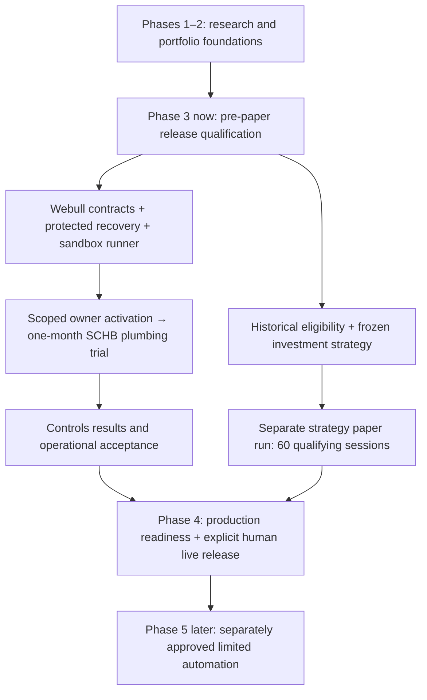

# Trading launch plan — October 12, 2026

**Current phase: Phase 3 — pre-paper release qualification.** Phases 1–2 have research and portfolio foundations. Phase 3's historical/strategy evidence and broker-connected paper release are incomplete. Phase 4, human-approved live trading, has not started; Phase 5 automation is a later separate decision.

The integrated disposable passkey/guardian controls ceremony is independently accepted at 100%. It proves a controls-test boundary, not source correctness, investment-strategy eligibility, production risk readiness or trading permission. No sandbox orders or month trial have started. Launch is 0%; overall readiness has no accepted percentage. Earlier Alpaca 64% component snapshots do not transfer to Webull.

[Open the interactive visual plan](visuals/trading-launch-plan.html). [Read the planning JSON](examples/trading-launch-plan/plan-2026-10-12.json).

## Next phase work package

Continue Phase 3 with [Webull source and runtime release qualification](webull-release-work-package.md). This is engineering/release preparation, not a broker activation. Source contracts and protected recovery can be worked in parallel; order-enabled startup depends on both.

| Before sandbox paper startup | Missing work / evidence | Owner |
| --- | --- | --- |
| Trusted provider sources | Quote timestamp/entitlement; current SCHB halt status and coverage; coherent account/cash/activity baseline; event type, coverage and reconnect reconciliation | Webull API/support answers; engineering integration |
| Protected controller | Current-key/revocation/history policy enforcement; atomic reset admission; account-bound operational review | Engineering, then necessary owner authentication |
| Webull plumbing runner | Explicit port/freeze of the existing Alpaca-only SCHB plumbing scope; idempotent orders, reservations, fills, settlement, loss/exposure checks and bounded supervision | Engineering |
| Deployment qualification | Actual runtime/broker credential boundary; current one-second clock evidence; kill switch, outages/restarts, reconciliation; resolve untested remote-host rejection | Engineering; owner infrastructure/actions where needed |
| Final startup | Verified actual selected cash-account baseline; acceptance report; required scoped owner activation and persistent month runtime | Engineering and owner |

There is an actual migration gap: `conf/paper-etf-plumbing.json` still selects Alpaca-only status and says `runtime_integrated=false`. The plan does not edit or silently relabel it. Current Webull scope is retail cash sandbox, SCHB ETF controls plumbing only; INTC remains disabled. Actual account equity supplies whole-account denominators; the approved USD 1,000 sleeve ceiling remains distinct.

## Dates: conditional scenarios, not commitments

| Milestone | Planning estimate | Conditions |
| --- | --- | --- |
| Webull sandbox plumbing start | **November 2–23, 2026** | Useful provider answers by roughly October 19–26, plus approximately 2–4 weeks of remaining integration/qualification partly in parallel, no major redesign, all acceptance and owner startup gates passed |
| First calendar-month review | **December 2–23, 2026** | Actual trial starts within that window; one calendar month runs from actual qualified startup |
| Eligible strategy's forward paper | **January 2027, illustrative only** | Historical/source evidence qualifies, a real frozen strategy becomes eligible and the qualifying run is separately approved; neither is true yet |
| Human-approved live pilot | **April–May 2027, very low confidence** | January strategy paper start, 60 qualifying sessions with acceptable results, another 2–4 weeks for review/production qualification, and explicit live release |

Provider response timing and remaining implementation effort are unknown. The paper window is a low-confidence engineering planning assumption. Live has **no committable start date** because no investment strategy is currently eligible. These forecasts do not create tasks that automatically launch trading on those dates.

An investment-strategy qualifying paper start on January 4, 2027 reaches its 60th scheduled NYSE session on March 31. A January 19 start reaches April 14. These are planning calculations from the [published NYSE holiday schedule](https://www.nyse.com/trade/hours-calendars), assuming every scheduled session qualifies and no extraordinary closures occur. Early-close days count only if the evidence meets qualification rules. Missing evidence moves the finish later.

The month-long plumbing run does **not** satisfy those 60 investment-strategy sessions. It can identify operational defects, not demonstrate an untested research strategy's profitability. Historical evidence/strategy qualification may proceed independently, within approved scope; the 2026 OOS remains sealed.

## Additional requirements for live trading

- Historical/data and frozen strategy eligibility; 60 actual qualifying forward sessions and acceptable strategy/risk results.
- Production Webull account and funding verification, live adapter and live-grade data/status coverage. The deferred Nasdaq requirement before live/individual stocks remains unless explicitly amended; no equivalent or new feed is silently adopted.
- Deployed production controls with verified whole-account baseline, settlement, loss/exposure, reconciliation, kill switch, audit and recovery. Approved policy design does not activate production configuration.
- Independent environment approval and explicit human live release. A human-approved live pilot is Phase 4; autonomous limited execution would require Phase 5 evidence and separate permission.

The next external input is the [prepared Webull technical request](webull-provider-evidence-questions.md). Webull supplies its technical answers; the owner submits through authenticated support and shares the response. Independent engineering work can continue while it is pending. No API secrets or account identifiers belong in the request or chart.
